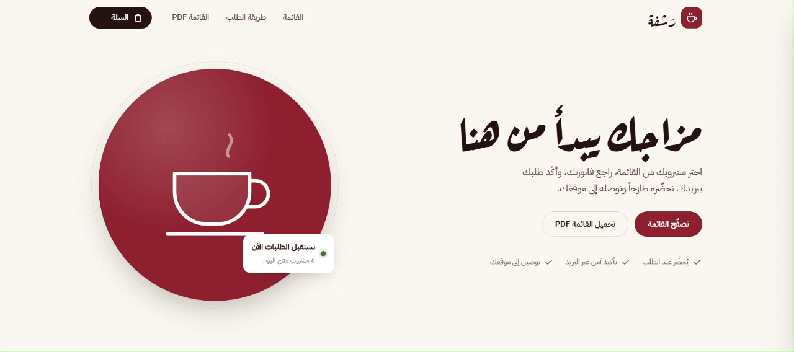
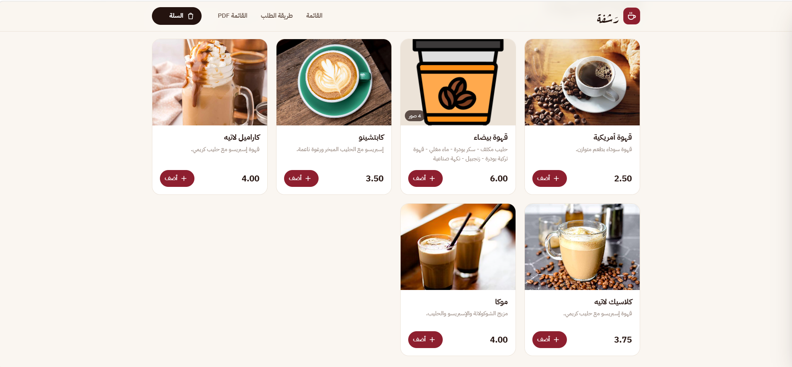
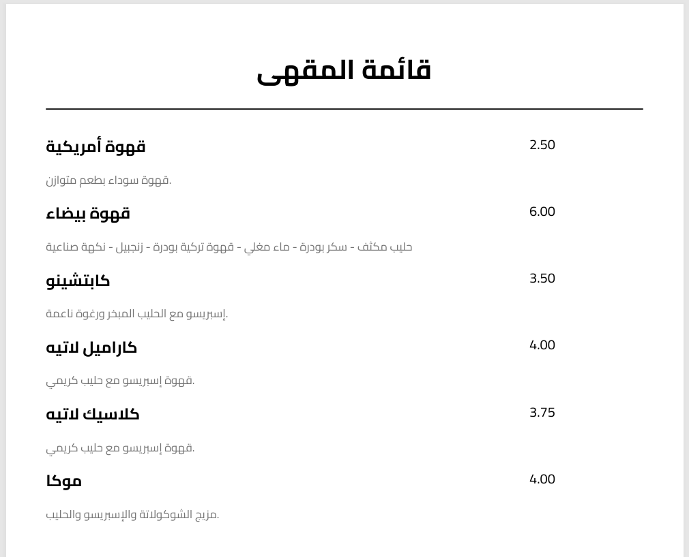
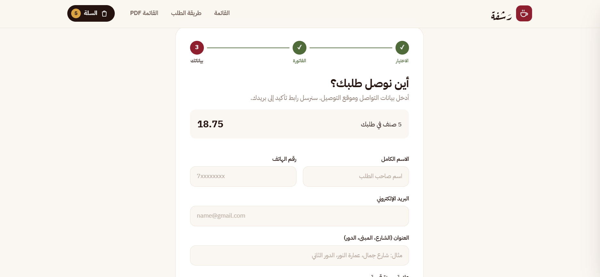

 <div align="center">

# ☕ Cafe Management & Online Ordering System

### A Modern Web Application for Cafe Operations and Online Ordering



**Designed to simplify cafe operations and provide customers with a convenient ordering experience.**

[](https://github.com/AbdullahAlwiAlshatry/Cafe)
[](https://dotnet.microsoft.com/)
[](https://learn.microsoft.com/en-us/dotnet/csharp/)

</div>

---

## 📖 About the Project

**Cafe Management & Online Ordering System** is a modern web application designed to simplify cafe operations and provide customers with a convenient online ordering experience.

The project combines an organized digital menu, order management, and a user-friendly interface to make the ordering process smoother and more accessible.

## ✨ Main Features

- **Digital Menu:** Browse cafe products and menu items.
- **Online Ordering:** A convenient interface for placing orders.
- **Order Stages:** Follow the different stages of an order.
- **PDF Menu Design:** Professionally formatted menu documents.
- **Responsive Interface:** Designed to provide a suitable experience across different screen sizes.

## 🖼️ Screenshots & Preview

### 1. Cafe Logo & Identity

<p align="center">
  
</p>

### 2. Digital Menu

<p align="center">
  
</p>

### 3. PDF Menu Design

<p align="center">
  
</p>

### 4. Order Stages

<p align="center">
  
</p>

---

## 🛠️ Technologies Used

| Technology | Purpose |
|---|---|
| C# | Main programming language |
| ASP.NET Core | Web application framework |
| .NET 10 | Application platform |
| Entity Framework Core | Database access and ORM |
| SQLite | Database |
| QuestPDF | PDF document generation |
| MailKit | Email integration |
| HTML, CSS, JavaScript | Frontend development |

## 🏗️ Project Structure

The project follows an organized ASP.NET Core structure:

- `Controllers/` – Application controllers.
- `Data/` – Database-related components.
- `Models/` – Application data models.
- `Services/` – Application services.
- `ViewModels/` – View-specific data models.
- `Views/` – User interface views.
- `wwwroot/` – Static assets such as images, CSS, and JavaScript.

## 🚀 Getting Started

### Prerequisites

- .NET 10 SDK
- Visual Studio 2026 or Visual Studio Code

### Installation

1. Clone the repository:

```bash
git clone https://github.com/AbdullahAlwiAlshatry/Cafe.git
```

2. Navigate to the project directory:

```bash
cd Cafe
```

3. Restore the required packages:

```bash
dotnet restore
```

4. Run the application:

```bash
dotnet run
```

5. Open the local URL displayed in the terminal.

## 📂 Repository

The complete source code is available on GitHub:

**[AbdullahAlwiAlshatry / Cafe](https://github.com/AbdullahAlwiAlshatry/Cafe)**

## 👨‍💻 Developer

**Abdullah Alwi Alshatry**

---

<div align="center">

### ☕ Built with passion for better cafe experiences.

**Thank you for visiting this project!**

</div>
